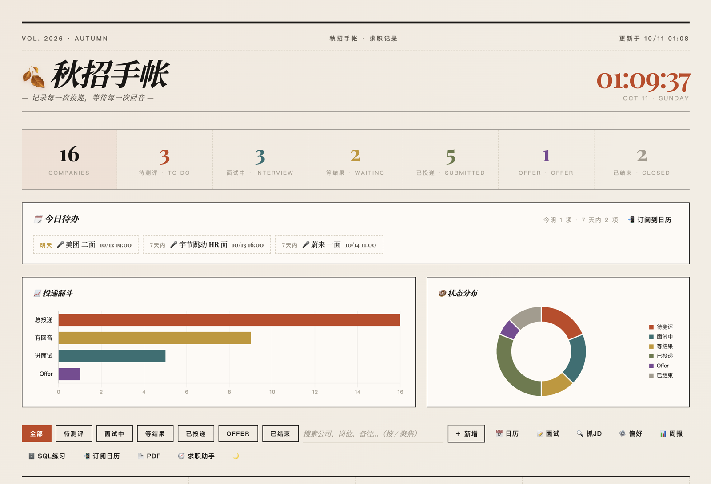
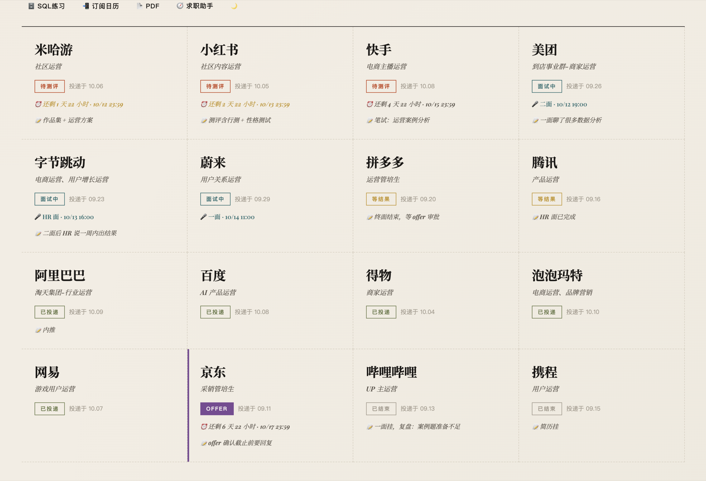
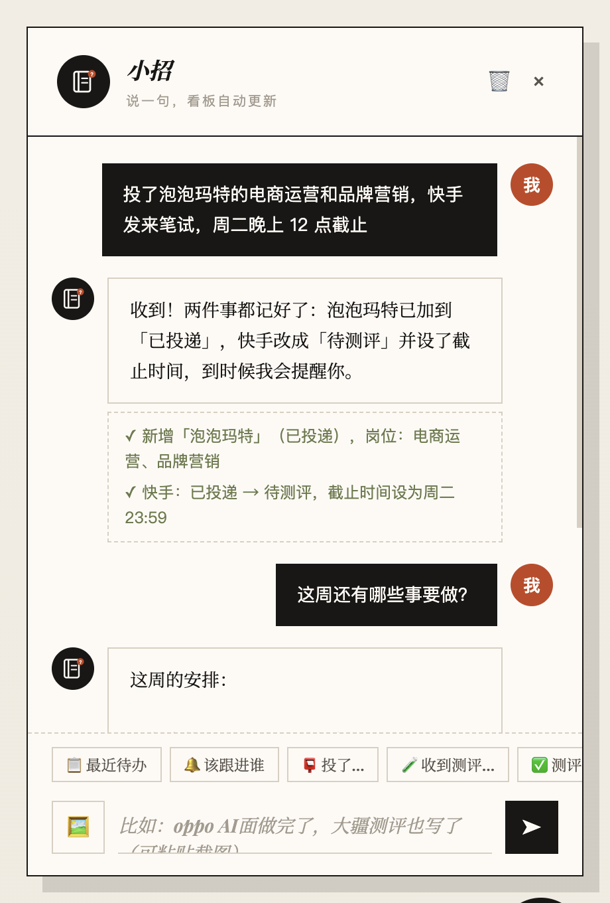

# 🍂 秋招手帐 · 秋招看板

管理「投递之后」的一切：测评截止、面试安排、等结果、Offer。网页看板 + 一个能直接改看板的 AI 助手「小招」。



| 公司卡片（截止倒计时、面试时间、备注） | 小招：说一句，看板自动更新 |
| --- | --- |
|  |  |

> 截图里的公司进度、面试记录和对话都是 [`demo/seed_demo.py`](demo/seed_demo.py) 生成的虚构数据。

同一套求职工作流里的另外两个项目：

- [job-hunter](https://github.com/oxygenxx77/job-hunter)：求职助手，采集岗位 + AI 匹配 + 辅助投递
- [resume-autofill](https://github.com/oxygenxx77/resume-autofill)：网申简历自动填充浏览器扩展

## 功能

- **看板**：每家公司一张卡片，6 个状态（待测评 / 面试中 / 等结果 / 已投递 / Offer / 已结束），顶部统计、投递漏斗、状态分布图
- **今日待办**：测评截止和面试按时间排好，「明天」「7 天内」分级提醒
- **小招（AI 助手）**：用大白话说进展，一次说好几家也行，例如「美团约了二面，周五下午三点」「TCL 发来测评，3 天内完成」。小招通过工具调用改看板、记面试、算截止时间，每次改了什么都列在回复下面，改错了一键撤销。支持粘贴截图（测评邮件、面试通知）
- **面试记录 & 面试模拟**：记录每轮面试的题目和复盘；模拟面试时小招扮演面试官，结合简历追问，结束后打分并给改进建议
- **日历订阅**：生成 iCal 订阅地址，测评截止和面试自动出现在系统日历里，提前提醒
- **微信提醒**：配置 Server 酱后，截止前 24h / 2h、面试前 24h / 1h 推送到微信，每天早上推送当日待办
- **周报**：统计一周的投递和状态变化，可让小招点评
- **JD 抓取**：输入「公司 + 岗位」，联网搜索整理 JD
- **SQL 练习**：看板数据实时同步到 SQLite（只读副本），内置 10 个由浅入深的查询例子，还能和求职助手的岗位库跨库 JOIN
- **与求职助手联动**：求职助手里标记已投递的岗位自动进看板；小招能读求职助手的岗位库，回答「还有什么值得投」

## 实现要点

```
qiuzhao-kanban/
├── main.py        # FastAPI 路由，同时托管 index.html
├── agent.py       # 小招：OpenAI 兼容接口 + function calling，改看板前存撤销快照
├── board.py       # 看板 / 面试的业务操作（网页和小招共用同一套校验）
├── storage.py     # JSON 原子写入、自动备份、撤销快照、公司名归一匹配
├── agenda.py      # 今日待办、提醒推送、周报、iCal 订阅
├── sqlmirror.py   # 数据变化时同步到 kanban.db，供 SQL 练习
├── jobhunter.py   # 只读求职助手的 jobs.db 和简历
├── index.html     # 单文件前端（原生 JS + Chart.js）
└── demo/seed_demo.py
```

- 数据存在本地 JSON 文件里：先写临时文件再替换（断电不会写坏），每次修改前自动备份，保留最近 30 份
- 小招的每次修改都先存快照；撤销时检查快照之后看板有没有被别人改过，有的话先提示，避免把别的改动一起回退
- 小招声称「已更新」却没调用工具时，后端会自动追问一次，防止 AI 只嘴上答应
- 公司名匹配会去掉城市前缀和「有限公司 / 集团 / 科技」等后缀，「金山」能找到「金山办公」，但有歧义时不会乱猜

## 快速开始

需要 Python 3.9+。

- **Mac**：双击 `install-mac.command`
- **Windows**：双击 `install-windows.bat`

安装脚本会创建虚拟环境、安装依赖、生成 `.env` 和启动脚本，完成后浏览器打开 <http://127.0.0.1:8000>。

手动安装：

```bash
python3 -m venv venv && source venv/bin/activate
pip install -r requirements.txt
cp .env.example .env      # 不填 Key 也能用，只是没有 AI 功能
uvicorn main:app --port 8000
```

详细说明见 [使用说明.txt](使用说明.txt)。

### 用演示数据试玩

```bash
cp -R qiuzhao-kanban /tmp/kanban-demo
python3 qiuzhao-kanban/demo/seed_demo.py /tmp/kanban-demo
cd /tmp/kanban-demo && uvicorn main:app --port 8010
```

脚本会拒绝写入已有看板数据的目录，不会覆盖真实记录。

## 隐私

- 投递记录、面试记录、聊天记录都只存在本机文件夹里
- `.gitignore` 是白名单式的：默认忽略所有文件，只放行代码、示例和文档，数据文件和 `.env` 不会被误提交
- 截图和 `demo/` 里的数据全部是虚构的

## 许可证

[MIT](LICENSE)
